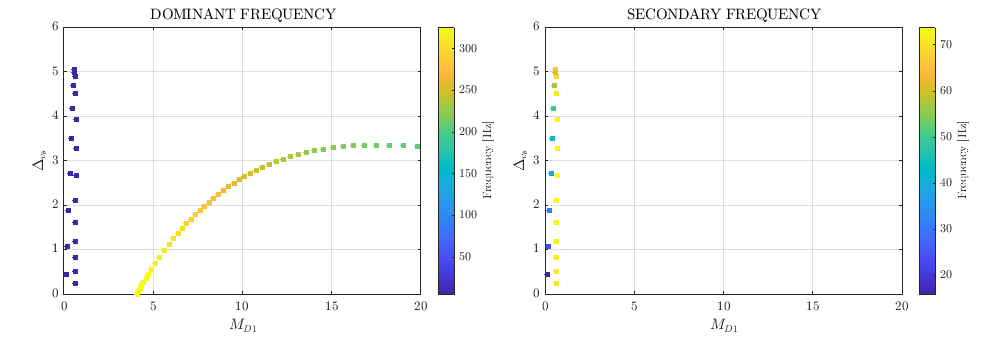
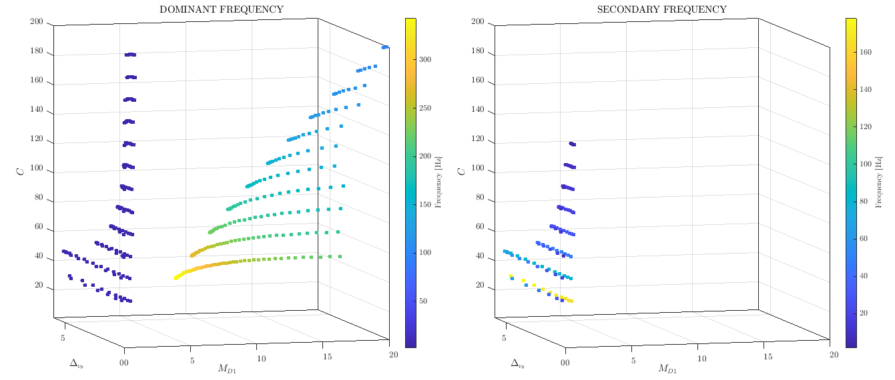
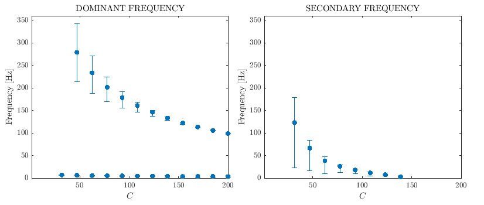
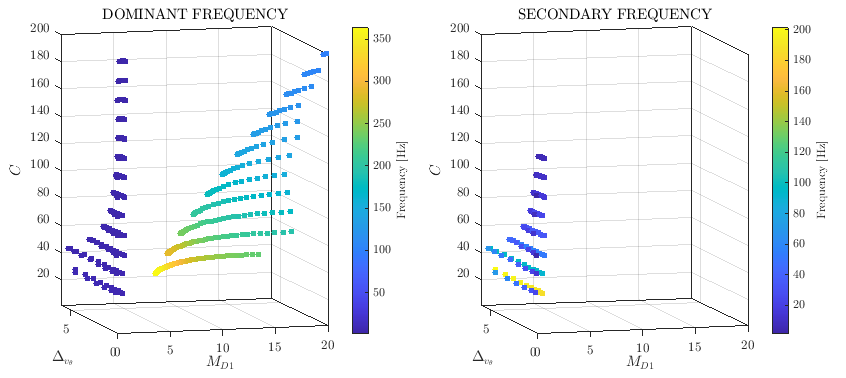
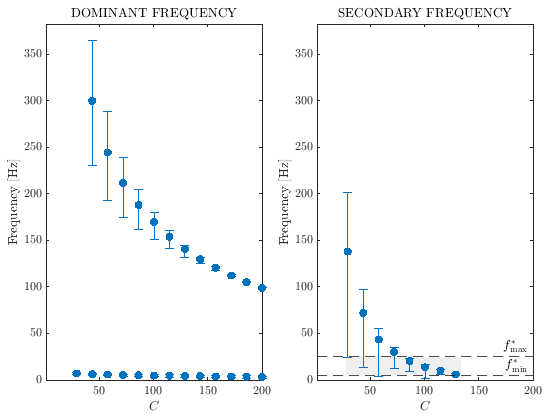
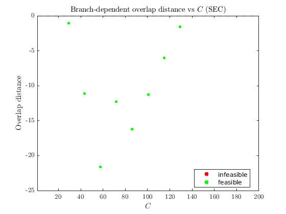

# Minimal Hopf frequency estimation package

This folder contains the three main frequency-estimation scripts and their direct dependencies.

## Contents

- `script_NMM_fast_freq_estim_01_SLICE.m` – single 2-D Hopf slice
- `script_NMM_fast_freq_estim_02_PARFOR_SLICES.m` – coarse grid of 2-D slices along a third parameter
- `script_NMM_fast_freq_estim_03_TARGET_BAND.m` – target-band search with boundary refinement
- `Dopamine_NMM_fast4.m` – NMM model definition (only file needed from `MatcontSystems`)


## Prerequisites

MatCont : download from [https://sourceforge.net/projects/matcont/]() and add to matlab path.

## Script descriptions

### `script_NMM_fast_freq_estim_01_SLICE.m`

Computes a single Hopf bifurcation slice in a 2-D parameter plane.

- Default plane: `par1 = Md` (parameter 4) vs. `par2 = Delta` (parameter 9)
- Continues an equilibrium branch in `par1`, detects Hopf points, then continues each Hopf point in the `(par1, par2)` plane
- Reports dominant and secondary oscillation frequencies (Hz) for the valid Hopf branch segments inside the requested parameter box
- Produces a 2-D scatter plot (dominant and secondary frequency)

Output example:

```
=== SINGLE SLICE COMPUTATION SUMMARY ===
-----------------------------------------------------------------------------------------------------------------------
                #        DOMINANT FREQUENCY        #        SECONDARY FREQUENCY       # 
item            # [f_min, f_max] | f_mean | f_std  # [f_min, f_max] | f_mean | f_std  # n_points | status              
=======================================================================================================================
slice           #    5.7  326.0  |  190.1 |  125.6 #   15.9   73.9  |   58.9 |   18.7 #  67 / 2  | ok                  
     branch 1   #    5.7    6.4  |    6.0 |    0.2 #   15.9   73.9  |   58.9 |   18.7 #  20      |                     
     branch 2   #  207.0  326.0  |  268.5 |   40.4 #                |        |        #  47      |                     
-----------------------------------------------------------------------------------------------------------------------

```



### `script_NMM_fast_freq_estim_02_PARFOR_SLICES.m`

Runs `script_NMM_fast_freq_estim_01_SLICE`-style computations for many values of a third parameter (`par3`) in parallel.

- Default `par3 = C` (parameter 1), scanned from 1 to 200
- Uses `parfor` over a `par3` grid
- Collects per-slice statistics and aggregates all valid points into a 3-D scatter plot
- Also produces a diagnostic error-bar plot of dominant/secondary frequency ranges versus `par3`

This gives a coarse overview of how the Hopf frequency bands vary across three parameters.

Example output:

```matlab
=== COARSE GRID COMPUTATION SUMMARY ===
-----------------------------------------------------------------------------------------------------------------------
                #        DOMINANT FREQUENCY        #        SECONDARY FREQUENCY       # 
item            # [f_min, f_max] | f_mean | f_std  # [f_min, f_max] | f_mean | f_std  # n_points | status              
=======================================================================================================================
par3 = 1        #                |        |        #                |        |        #  0 / 0   | no_hopf_on_EP       
-----------------------------------------------------------------------------------------------------------------------
par3 = 16.3     #                |        |        #                |        |        #  0 / 0   | no_hopf_on_EP       
-----------------------------------------------------------------------------------------------------------------------
par3 = 31.6     #    6.3    7.8  |    6.9 |    0.6 #   22.8  178.4  |  123.3 |   64.1 #  16 / 1  | ok                  
     branch 1   #    6.3    7.8  |    6.9 |    0.6 #   22.8  178.4  |  123.3 |   64.1 #  16      |                     
-----------------------------------------------------------------------------------------------------------------------
par3 = 46.9     #    5.8  343.4  |  194.6 |  132.2 #   16.8   84.0  |   66.4 |   21.6 #  71 / 2  | ok                  
     branch 1   #    5.8    6.4  |    6.1 |    0.2 #   16.8   84.0  |   66.4 |   21.6 #  22      |                     
     branch 2   #  214.6  343.4  |  279.3 |   43.0 #                |        |        #  49      |                     
-----------------------------------------------------------------------------------------------------------------------
par3 = 62.2     #    4.5  271.3  |  162.2 |  109.5 #   10.1   47.3  |   38.4 |   12.1 #  51 / 2  | ok                  
     branch 1   #    4.5    6.2  |    5.6 |    0.4 #   10.1   47.3  |   38.4 |   12.1 #  16      |                     
     branch 2   #  187.9  271.3  |  233.8 |   28.7 #                |        |        #  35      |                     
-----------------------------------------------------------------------------------------------------------------------
par3 = 77.5     #    4.0  224.9  |  136.4 |   95.2 #   11.9   29.8  |   26.2 |    5.7 #  39 / 2  | ok                  
     branch 1   #    4.0    6.1  |    5.3 |    0.6 #   11.9   29.8  |   26.2 |    5.7 #  13      |                     
     branch 2   #  169.3  224.9  |  201.9 |   19.4 #                |        |        #  26      |                     
-----------------------------------------------------------------------------------------------------------------------
par3 = 92.8     #    3.7  192.5  |  116.9 |   85.0 #   10.2   19.8  |   17.9 |    3.1 #  31 / 2  | ok                  
     branch 1   #    3.7    6.0  |    5.1 |    0.7 #   10.2   19.8  |   17.9 |    3.1 #  11      |                     
     branch 2   #  155.3  192.5  |  178.5 |   13.0 #                |        |        #  20      |                     
-----------------------------------------------------------------------------------------------------------------------
par3 = 108      #    3.3  168.6  |  102.5 |   77.6 #    5.0   13.3  |   11.4 |    2.9 #  24 / 2  | ok                  
     branch 1   #    3.3    5.6  |    4.7 |    0.7 #    5.0   13.3  |   11.4 |    2.9 #  9       |                     
     branch 2   #  146.2  168.6  |  161.1 |    7.7 #                |        |        #  15      |                     
-----------------------------------------------------------------------------------------------------------------------
par3 = 123      #    2.8  150.3  |   81.7 |   72.3 #    4.9    8.3  |    7.5 |    1.2 #  22 / 2  | ok                  
     branch 1   #    2.8    5.5  |    4.4 |    0.9 #    4.9    8.3  |    7.5 |    1.2 #  10      |                     
     branch 2   #  136.9  150.3  |  146.2 |    4.5 #                |        |        #  12      |                     
-----------------------------------------------------------------------------------------------------------------------
par3 = 139      #    2.5  135.8  |   72.2 |   66.3 #    1.9    3.0  |    2.6 |    0.5 #  19 / 2  | ok                  
     branch 1   #    2.5    5.3  |    4.2 |    0.9 #    1.9    3.0  |    2.6 |    0.5 #  9       |                     
     branch 2   #  128.2  135.8  |  133.4 |    2.6 #                |        |        #  10      |                     
-----------------------------------------------------------------------------------------------------------------------
par3 = 154      #    2.3  124.1  |   66.5 |   61.0 #                |        |        #  17 / 2  | ok                  
     branch 1   #    2.3    4.9  |    3.7 |    0.9 #                |        |        #  8       |                     
     branch 2   #  118.9  124.1  |  122.4 |    1.8 #                |        |        #  9       |                     
-----------------------------------------------------------------------------------------------------------------------
par3 = 169      #    2.2  114.3  |   55.0 |   56.6 #                |        |        #  15 / 2  | ok                  
     branch 1   #    2.2    4.8  |    3.8 |    0.9 #                |        |        #  8       |                     
     branch 2   #  112.0  114.3  |  113.5 |    0.9 #                |        |        #  7       |                     
-----------------------------------------------------------------------------------------------------------------------
par3 = 185      #    2.5  106.1  |   46.2 |   52.5 #                |        |        #  12 / 2  | ok                  
     branch 1   #    2.5    4.6  |    3.7 |    0.8 #                |        |        #  7       |                     
     branch 2   #  105.2  106.1  |  105.7 |    0.4 #                |        |        #  5       |                     
-----------------------------------------------------------------------------------------------------------------------
par3 = 200      #    2.1   99.2  |   27.2 |   44.4 #                |        |        #  8 / 2   | ok                  
     branch 1   #    2.1    4.2  |    3.3 |    0.8 #                |        |        #  6       |                     
     branch 2   #   99.0   99.2  |   99.1 |    0.1 #                |        |        #  2       |                     
-----------------------------------------------------------------------------------------------------------------------
```






### `script_NMM_fast_freq_estim_03_TARGET_BAND.m`

Searches for `par3` values where the Hopf frequency band overlaps a user-specified target band.

- Target band default: `[5, 25]` Hz
- Frequency mode: `'sec'` (secondary frequency) by default; can be set to `'dom'` for dominant frequency
- Coarse scan over `par3`, then boundary refinement around the transitions into/out of the feasible region
- Reports feasible `par3` intervals and refinement brackets
- Plots the target band, feasible regions, and branch-wise overlap distance

Use this script to identify parameter ranges that place the oscillation frequency inside a desired band.

```matlab
Feasible coarse intervals in par3:    [29.43, 128.9]

=== REFINEMENT SUMMARY ===
Lower-bound bracket in par3:   [27.65, 28.54]
Upper-bound bracket in par3:   [133.4, 134.3]
Estimated par3 interval:       [28.1, 133.8]
Upper bound on bracket width:  0.8884 (~0.45% of par3range span)
```







## Common settings

All three scripts share a parameter vector:

```matlab
pars = [C, Iext, ujump, Md, B, gammaa, Vr, Vt, Delta, cexc, Ta, K]
```

and an initial equilibrium guess:

```matlab
cfg.x0_eq = [0.006; -70; -50; 0.06];
```

The active parameter indices and ranges can be changed in the `%% USER SETTINGS` block of each script.
