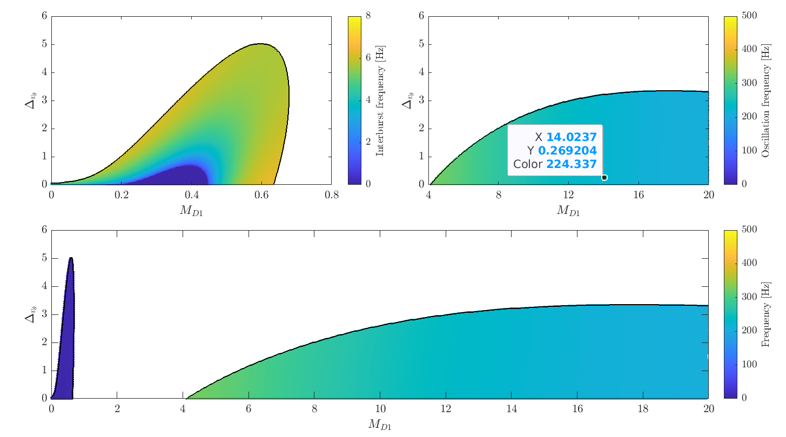

# Eigenvalue-based frequency mapping in the `(M_D1, Δ)` plane

This folder contains a MatCont-based MATLAB script that compares several strategies for estimating oscillation frequencies inside the two oscillatory "bubbles" of the Gast-type dopaminergic neural mass model in the $(M_{D1}, \Delta_{v_\theta})$ parameter plane.

The two bubbles correspond to dynamically distinct regimes:

- **Left (low `M_D1`) bubble** — collective slow–fast **bursting**. The relevant frequency is the **interburst** (envelope) frequency.
- **Right (high `M_D1`) bubble** — collective **spiking** oscillations. The relevant frequency is the fast oscillation frequency.

Four frequency-estimation methods are implemented and can be selected via `opts.method`:

| Method                                 | Label | Idea                                                                                                                   | Typical cost |
| -------------------------------------- | ----- | ---------------------------------------------------------------------------------------------------------------------- | ------------ |
| Equilibrium continuation + eigenvalues | `EP`  | Continue equilibria from the Hopf boundary and extract frequencies from the imaginary part of complex eigenvalue pairs | ~40 s        |
| Limit-cycle continuation               | `LC`  | Continue periodic orbits from Hopf and use `f = 1000 / period`                                                         | ~30 min      |
| Simulation + Lomb–Scargle              | `LS`  | Time integration followed by a Lomb–Scargle periodogram                                                                | ~560–1500 s  |
| Simulation + peak detection            | `FP`  | Time integration followed by `findpeaks`                                                                               | ~260 s       |

The `EP` method is the fast, eigenvalue-based approximation proposed in the paper. The `LS` and `FP` methods are conventional simulation-based estimates. `LC` provides a more expensive continuation-based reference.

## Prerequisites

- MATLAB with the **MatCont** continuation package installed and on the MATLAB path.
- The model file `Dopamine_NMM_fast4.m` (provided in `coarse_continuation/` must be available on the path.

## Quick start

1. Copy or symlink `NMM_Gast_interburst_freq_estim_GRID.m` into your MatCont folder.
2. Make sure `Dopamine_NMM_fast4.m` is on the MATLAB path.
3. Open MATLAB, start a parallel pool (the script calls `parpool` automatically if none exists):
   ```matlab
   NMM_Gast_interburst_freq_estim_GRID
   ```

The default method is `EP` (fast eigenvalue-based estimation). To switch method, edit the block:

```matlab
% opts.method = 'LS';     % SIM & Lomb–Scargle periodogram
% opts.method = 'FP';     % SIM & findpeaks
opts.method = 'EP';     % Equilibrium Point continuation [default]
% opts.method = 'LC';     % Limit Cycle continuation
```

## Key settings

The most important tunables are grouped in the `%% SETTING` block near the top of the script:

```matlab
% Frequency estimation method
opts.method = 'EP';

% Bubble separation threshold
thrs  = 2;      % M_D1 value separating bursting (left) and spiking (right) bubbles
Md_max = 20;    % upper M_D1 bound for the right bubble

% Grid resolution
L_grid_size = [300, 200];   % [N_Md, N_Delta] for the left bubble
R_grid_size = [400, 200];   % [N_Md, N_Delta] for the right bubble
```

Method-specific continuation options are stored in `opts.EP`, `opts.LC`, or `opts.SIM`. For example, the EP settings include:

```matlab
opts.EP.MaxNumPts.L = 2000;     % left bubble
opts.EP.MaxNumPts.R = 2000;     % right bubble
opts.EP.MaxStepsize.L = 0.1;
opts.EP.MaxStepsize.R = 0.75;
```

## Outputs

- **`freq_data_<method>_new.mat`** — structure `data` containing:
  - `data.method` — used frequency estimation method.
  - `data.pars` — full parameter vector.
  - `data.L_bubble` / `data.R_bubble` — bubble geometry and grid definitions.
  - `data.L_freq` / `data.R_freq` — `(4, N_Md, N_Delta)` arrays containing `M_D1`, `Delta`, `f_dom`, and `f_sec` for each grid point.
  - `data.opts` — options struct used for the run.
  - `data.cost` — computational cost summary (timings, coverage, continuation points, eigenvalue spectra, failures).

