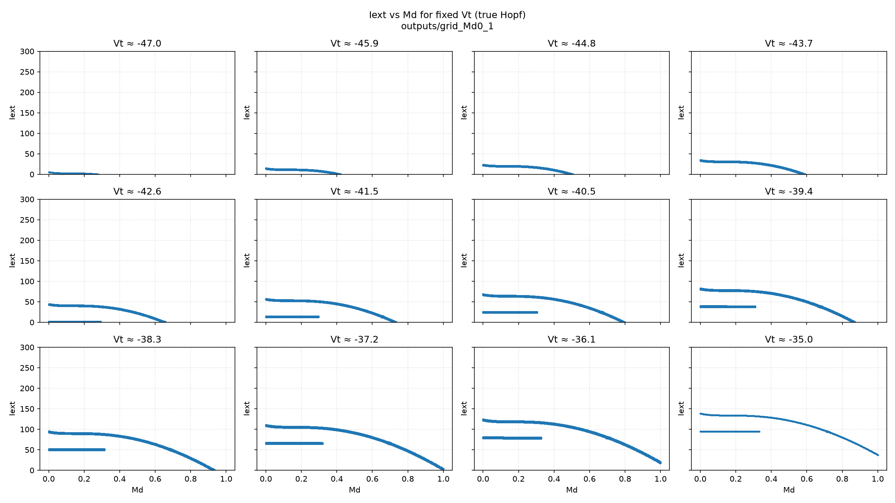
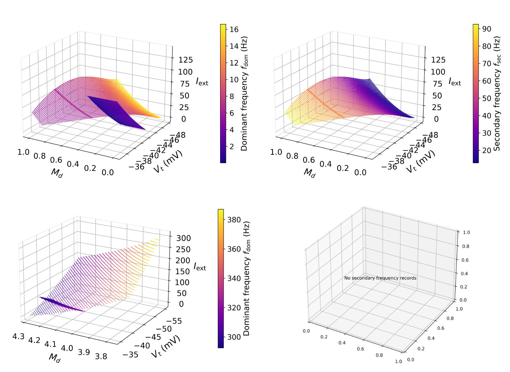

# Gast-type neuromodulation model — Hopf grid search

This repository contains a Python implementation of a grid search over the
Hopf bifurcation locus of the Gast-type neuromodulation model described in
`INSTRUCTIONS_next_steps.md`, `params.md`, and `alg_notes.md`.

The symbolic Hopf manifold and equilibrium coefficients are provided by
`gast_coeffs.py` and `gast_hopf_frequency.py`.  This workflow focuses on the
numerical grid search in the `(Md, Vt)` plane and on visualising the resulting
Hopf frequencies.

## Dependencies

Create and activate a Python virtual environment, then install the required
packages:

```bash
python3 -m venv venv
source venv/bin/activate
pip install sympy numpy matplotlib plotly joblib
```

All scripts below assume the virtual environment is activated.


| File | Purpose |
|------|---------|
| `gast_coeffs.py` | Symbolic equilibrium and Hopf coefficients |
| `gast_hopf_frequency.py` | Fixed-parameter substitutions and `Iext` root solver |
| `sweep_Md.py` | 1-D `Md` sweep at constant `Vt` |
| `gast_hopf_grid.py` | 2-D `(Md, Vt)` grid computation |
| `run_grid_search.py` | Master script that reproduces all grid data |
| `plot_Iext_vs_Md_cuts.py` | Generate 1-D `Iext`-vs-`Md` cut panels |
| `render_3d_frequency.py` | Generate interactive 3-D Plotly frequency plot |
| `render_3d_frequency_static.py` | Generate publication-quality static 3-D frequency figure |
| `params.md` / `alg_notes.md` | Model parameters and equations |


## Generating the data

The master script `run_grid_search.py` generates all input data used by the
plotting and analysis scripts.  By default everything is written under the
`outputs/` directory (use `--outdir <dir>` to change this).

```bash
# Run the full pipeline (1-D sweep + both 2-D grids)
python3 run_grid_search.py
```

Default grids:

| Grid | Md range | Vt range | Resolution | Output directory |
|------|----------|----------|------------|------------------|
| 1-D sweep | `[0, 20]` | `Vt = -43` | 401 points | `outputs/sweep_Md/` |
| Low-Md 2-D | `[0, 1]` | `[-55, -35]` | `301 × 101` | `outputs/grid_Md0_1/` |
| High-Md 2-D | `[2.5, 5]` | `[-55, -35]` | `301 × 101` | `outputs/fine_grid_Md2.5_5/` |

Run only selected parts:

```bash
python3 run_grid_search.py --only-sweep
python3 run_grid_search.py --only-low-md
python3 run_grid_search.py --only-high-md
```

Use custom resolutions, for example:

```bash
python3 run_grid_search.py --n-md-low 401 --n-vt-low 101 --n-md-high 401 --n-vt-high 101
```

Run in parallel on all available cores:

```bash
python3 run_grid_search.py --n-jobs -1
```

Use a specific number of workers:

```bash
python3 run_grid_search.py --n-jobs 16
```

With the quadratic `r`-solver pre-lambdified (see `sweep_Md.py`), the full
pipeline runs in ~30 seconds on a single core.  With `joblib` parallelism
(`--n-jobs -1` uses all cores), it drops to ~9 seconds:

| Stage | Single-core | Parallel (`n_jobs=-1`) |
|-------|-------------|------------------------|
| 1-D sweep | ~17 s | ~2.4 s |
| Low-Md 2-D grid | ~3.8 s | ~3.0 s (first parallel call, pool warmup) |
| High-Md 2-D grid | ~3.6 s | ~0.5 s |
| **Total (focused slices)** | **~27 s** | **~9 s** |

The first parallel stage pays a one-time process-pool startup cost; subsequent
stages reuse the warm pool and are much faster.

A full 2-D grid `Md [0, 20] × Vt [-55, -35]` at `2001 × 101` resolution
(202,101 points) takes about **6 s** in parallel on this machine and produces
~242,000 records.  Only ~3.7% of those are true Hopf points; true Hopf solutions
are confined to `Md ≲ 4.28`.

Each grid run saves into a subdirectory of `outputs/`:

- `gast_hopf_grid_results.csv` — table of records
- `gast_hopf_grid_results.npz` — NumPy archive including eigenvalues
- `gast_hopf_grid.png` — 2-D overview panels
- `gast_hopf_Iext_vs_Md.png` — 1-D Iext-vs-Md cuts

The 1-D sweep saves into `outputs/sweep_Md/`:

- `outputs/sweep_Md/sweep_Md_Vt-43.00.csv` / `.npz`
- `outputs/sweep_Md/sweep_Md_Vt-43.00.png`


## Notes on the frequency computation

Model time constants are in **ms**, so Jacobian eigenvalues are in **ms⁻¹**.
The frequency in Hz is therefore

```
f = |Im(λ)| / (2π) × 1000
```

The dominant frequency `f_dom` is assigned to the complex-conjugate pair whose
real part is closest to zero (the Hopf pair).  The secondary frequency `f_sec`
comes from any additional complex-conjugate pair.

Because the Hopf manifold `H₃ = 0` is only a *necessary* condition for a Hopf
bifurcation, some of its roots are **non-Hopf**:

- all eigenvalues are real (`f_dom = nan`), or
- the complex pair has a non-zero real part.

In the grids, roots with `Vt < -43` are almost always true Hopf points, while
roots with `Vt > -43` contain a large fraction of spurious non-Hopf roots.


## Generating the plots

### 1-D Iext-vs-Md cuts for fixed Vt

```bash
python3 plot_Iext_vs_Md_cuts.py outputs/grid_Md0_1/gast_hopf_grid_results.npz --true-hopf
python3 plot_Iext_vs_Md_cuts.py outputs/fine_grid_Md2.5_5/gast_hopf_grid_results.npz \
    --true-hopf --vt-cuts -42 -41 -40 -39 -38 -37 -36
```

Options include `--true-hopf`, `--vt-cuts`, `--iext-max`, and `--ncols`.




### Static 3-D frequency figure for papers

`render_3d_frequency_static.py` produces the same visualization as
`render_3d_frequency.py` but as high-resolution static images (PNG/PDF/SVG/EPS)
using Matplotlib.  True Hopf points are shown by default and coloured by the
dominant frequency $f_{\\mathrm{dom}}$.

```bash
python3 render_3d_frequency_static.py \
    outputs/grid_Md0_1/gast_hopf_grid_results.npz \
    outputs/fine_grid_Md2.5_5/gast_hopf_grid_results.npz
```

By default this saves each grid as a separate file with its own colorbar in
`outputs/` (`outputs/figure_3d_frequency_true_hopf_grid_Md0_1.png` / `.pdf` and
`outputs/figure_3d_frequency_true_hopf_fine_grid_Md2.5_5.png` / `.pdf`) using
600 dpi, a 10 × 7 inch panel size, `marker_size=2.2`, and `azim=120`.
Useful options:

- `--combined` — single 3-D panel instead of one panel per grid.
- `--no-separate` — single multi-panel figure with a shared colorbar.
- `--secondary` — colour by secondary frequency `f_sec` and keep only points
  where it is defined.
- `--vt-ticks -35 -40 -45 -50` — set custom `Vt` axis tick locations.
- `--dpi 300` / `--dpi 600` — raster resolution.
- `--width 10 --height 7` — per-panel figure size in inches.
- `--marker-size 2.2` — marker size.
- `--elev 20 --azim 120` — 3-D camera angle.
- `--formats png pdf svg` — output formats.


### Interactive 3-D frequency plot

```bash
python3 render_3d_frequency.py \
    outputs/grid_Md0_1/gast_hopf_grid_results.npz \
    outputs/fine_grid_Md2.5_5/gast_hopf_grid_results.npz

# Only true Hopf points
python3 render_3d_frequency.py \
    outputs/grid_Md0_1/gast_hopf_grid_results.npz \
    outputs/fine_grid_Md2.5_5/gast_hopf_grid_results.npz \
    --true-hopf -o outputs/interactive_3d_frequency_true_hopf.html
```

Open the resulting HTML file in a browser to rotate, zoom, and inspect
individual points.

## Key results

### Low-Md region (`Md ∈ [0, 1]`)

- Solutions exist only for `Vt ≳ -47.6 mV`.
- The left boundary of the Hopf region is curved in `(Md, Vt)` space.
- True Hopf frequencies are low: up to ~16 Hz (up to ~130 Hz when non-Hopf
  roots are included).
- Many points show two complex-conjugate pairs.

### High-Md region (`Md ∈ [2.5, 5]`)

- A narrow, genuine Hopf branch sits near `Md ≈ 4` across the full `Vt` range.
- This branch has high `Iext` values (up to ~300) and high frequencies
  (~265–390 Hz).
- For `Vt > -43` most manifold roots are spurious; filtering by
  `min |Re(λ)| < 10⁻³` is essential for interpretation.


